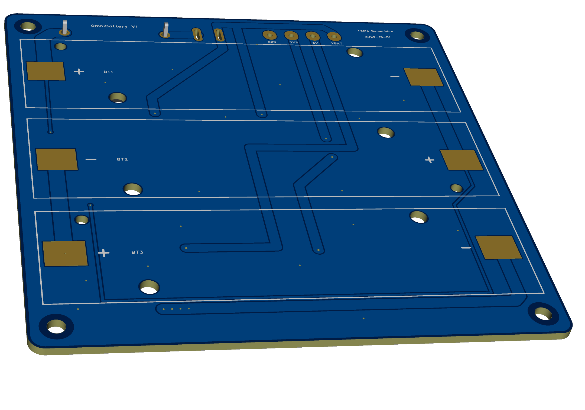
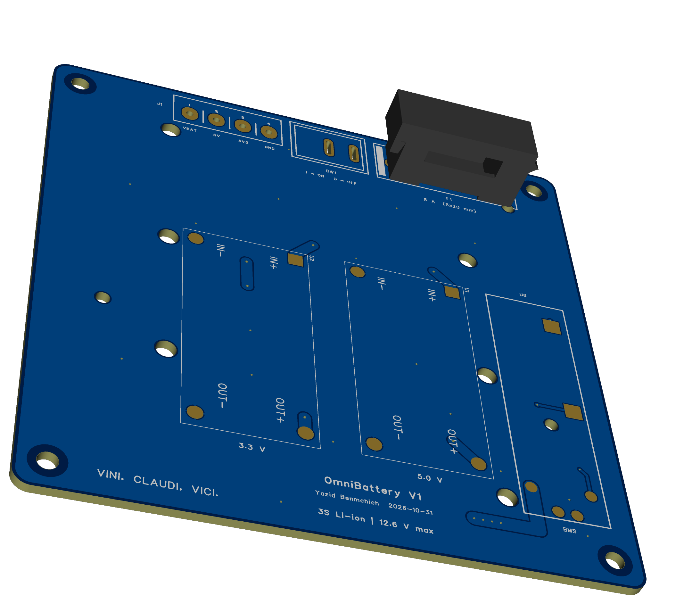
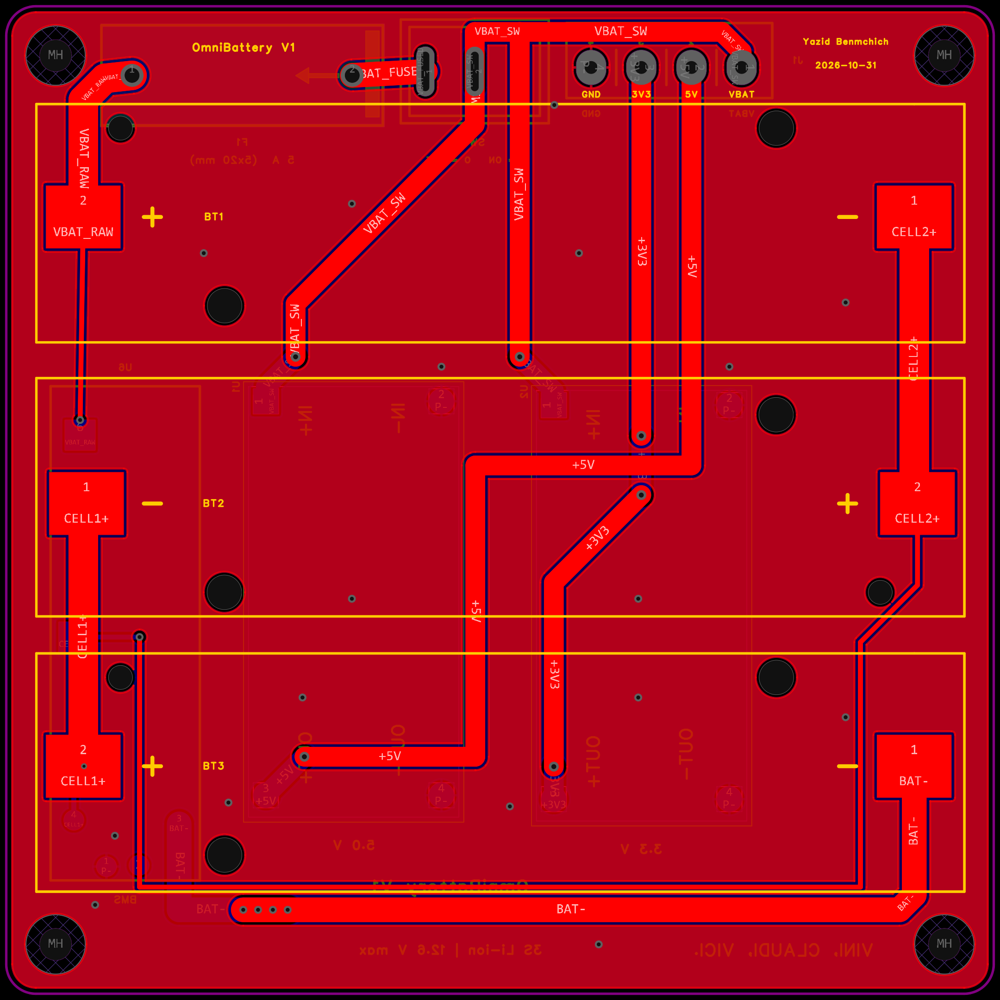
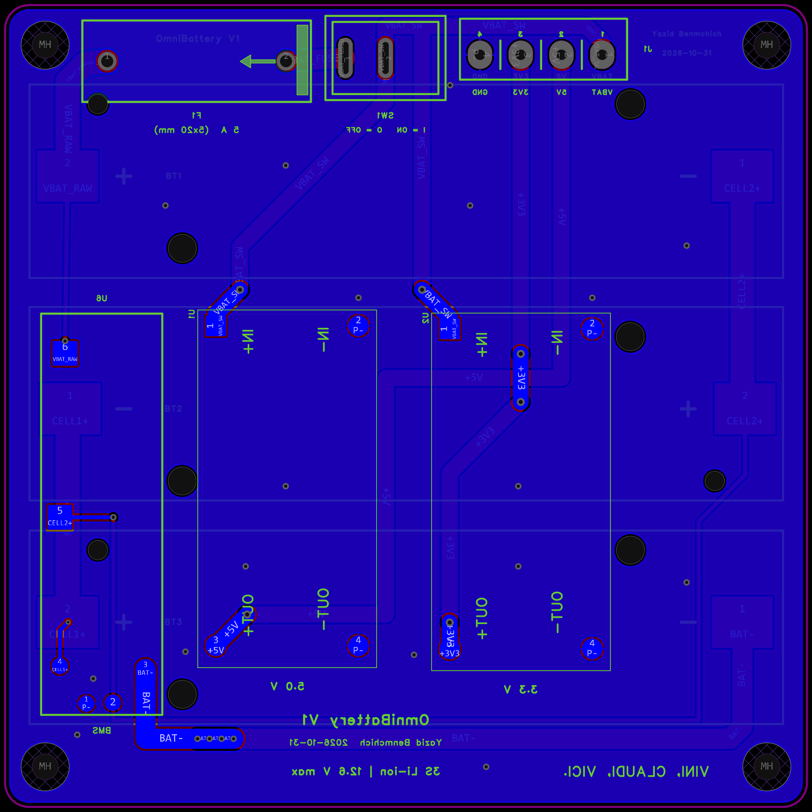
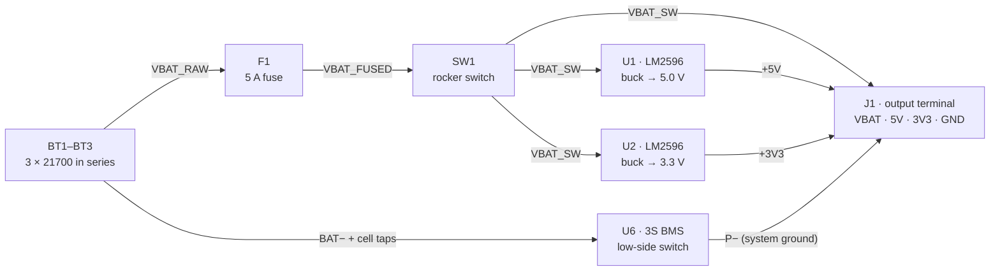

# OmniBattery

**A 3S 21700 Li-ion power board for my mobile robots.**

OmniBattery is a custom 2-layer PCB that holds three 21700 cells in series and gives a robot everything it needs from a single connector: fused and switched battery voltage, a regulated 5 V rail and a regulated 3.3 V rail. It powers my **OmniRobot** and **SelfBalancing-Robot** projects.

This repository documents **v1**, a deliberately simple, module-based board. **v2** will integrate everything onto one PCB (see the [Roadmap](#roadmap--v2)).

<table>
  <tr>
    <td></td>
    <td></td>
  </tr>
  <tr>
    <td align="center"><sub>3D preview, top: cell side (bare board)</sub></td>
    <td align="center"><sub>3D preview, bottom: power side (bare board)</sub></td>
  </tr>
  <tr>
    <td></td>
    <td></td>
  </tr>
  <tr>
    <td align="center"><sub>Top layer: cell side</sub></td>
    <td align="center"><sub>Bottom layer: power side (seen through the board from above)</sub></td>
  </tr>
</table>

> **Status:** v1 Rev B design is complete (October 2026). The fabrication files are in [`hardware/v1/revB`](hardware/v1/revB).

---

## At a glance

| | |
|---|---|
| **Cells** | 3 × 21700 Li-ion in series (3S), Keystone 1122 SMD holders |
| **Pack voltage** | 9.0–12.6 V (11.1 V nominal) |
| **Outputs** | `VBAT` (fused + switched) · `5V` · `3V3` · `GND` on one 4-pin 5.08 mm screw terminal |
| **Regulation** | 2 × LM2596 adjustable buck modules, set to 5.0 V and 3.3 V |
| **Protection** | 5 A fuse (5×20 mm) on the positive side, plus a 3S BMS module on the negative side (over-charge, over-discharge and short-circuit cut-off) |
| **Switch** | KCD1 rocker switch in series with pack + |
| **PCB** | 100 × 100 mm, 2 layers, 3 mm corner radius, 4 × M3 holes on a 90 mm square |
| **EDA** | EasyEDA Pro |

## Architecture



The [Rev B schematic (PDF)](hardware/v1/revB/OmniBattery_v1_revB_schematic.pdf) has the full circuit.

## Design notes

- **The BMS is on the low side; the fuse and switch are on the high side.** The BMS interrupts the negative path (B− → P−), and the fuse and power switch sit on the positive rail. The BMS senses B+ directly at the pack, upstream of the fuse, so it always sees the true cell voltages.
- **Two ground nets.** Everything on the board refers to the protected ground **P−**. Only the bottom cell's negative terminal and the BMS B− pad sit on **BAT−**. That net is routed as a dedicated 2.5 mm trace and kept out of the ground pour, so current can't bypass the BMS.
- **Copper.** P− is poured on both layers, and 17 vias tie the two layers together. Pack-current paths are 2.0–3.0 mm wide. The balance-sense taps (CELL1+, CELL2+, B+) are 0.5 mm, since they carry almost no current.
- **Two-sided placement.** The cells sit on top. The buck modules, BMS, fuse, switch and terminal are on the bottom. This keeps the board at 100 × 100 mm, the cheapest size tier at most PCB fabs.
- **Modules first.** v1 uses off-the-shelf buck and BMS modules. That got the robots a working, protected supply quickly, and it leaves the custom power electronics for v2, where they can be done properly.

## Revision history

### Rev A: first board
This board held three cells, two buck modules, a power switch and the output terminal. It had no fuse or BMS, and its top and bottom ground planes were joined at only one point.

Files are in [`hardware/v1/revA`](hardware/v1/revA).

### Rev B: current
- **5 A fuse** (5×20 mm holder) between the pack and the switch.
- **3S BMS module**, with the ground split into separate BAT− and P− nets.
- **Ground pours** on both layers, stitched with 17 vias.
- **Charging stays off-board** for v1. Cells are charged in an external charger.

Files are in [`hardware/v1/revB`](hardware/v1/revB).

## Known limitations of v1

- **No on-board charging.** The cells come out to be charged.
- **Module-based.** The board is bulkier than it needs to be. The LM2596 is a 150 kHz non-synchronous converter, so efficiency and output ripple are only average.
- **Total current is capped by the 5 A fuse.**
- **No telemetry.** The robot can't read pack voltage or current from the board.
- **The BMS can latch after a trip.** Some low-side BMS modules stay off after a short-circuit trip until they are reset; removing and re-inserting one cell resets them.

## Roadmap: v2

- A single PCB with no modules.
- 3–4 integrated buck converters.
- An integrated BMS.
- On-board charging.

## Repository layout

```
OmniBattery/
├── README.md
├── docs/images/                 3D previews and PCB layout images used in this README
└── hardware/v1/
    ├── revA/                    first board: schematic, Gerbers, BOM
    └── revB/                    current board
        ├── OmniBattery_v1_revB_schematic.pdf
        ├── OmniBattery_v1_revB_pcb_drawings.pdf     placement, layers and BOM
        ├── OmniBattery_v1_revB_gerbers.zip          ready for JLCPCB
        ├── OmniBattery_v1_revB_bom.csv
        ├── OmniBattery_v1_revB_schematic_source.json  (EasyEDA Pro)
        └── OmniBattery_v1_revB_pcb_source.json        (EasyEDA Pro)
```

## Building one

1. **Order the PCB.** Upload `OmniBattery_v1_revB_gerbers.zip` to JLCPCB (or any fab) with 2 layers and 1.6 mm thickness; the default options are fine.
2. **Get the parts** from the [BOM](hardware/v1/revB/OmniBattery_v1_revB_bom.csv). The 5 A 5×20 mm fuse goes into the holder and is bought separately.
3. **Set the buck modules first.** Power each LM2596 module from a bench supply at about 12 V. Turn its trimmer until the output reads **5.0 V** (U1) or **3.3 V** (U2). Only then solder them in.
4. **Solder the bottom side**: BMS, buck modules, fuse holder, switch and terminal. Then solder the cell holders on top.
5. **First power-up.** With SW1 off, fit the fuse and insert the cells, following the `+` / `−` marks. Switch on and measure `VBAT`, `5V` and `3V3` at J1 before connecting a robot.

## Safety

21700 cells can deliver tens of amps into a short. Always insert cells with the switch off and the polarity checked. Never bypass the fuse. Charge the cells only in a proper Li-ion charger (4.2 V per cell, 12.6 V for the pack).

---

**Author:** Yazid Benmchich, Microengineering, EPFL
